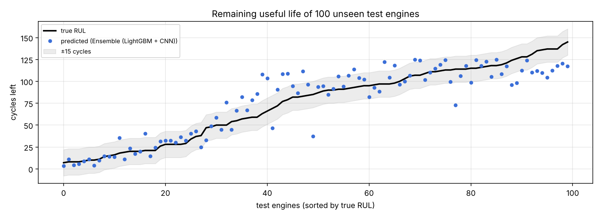
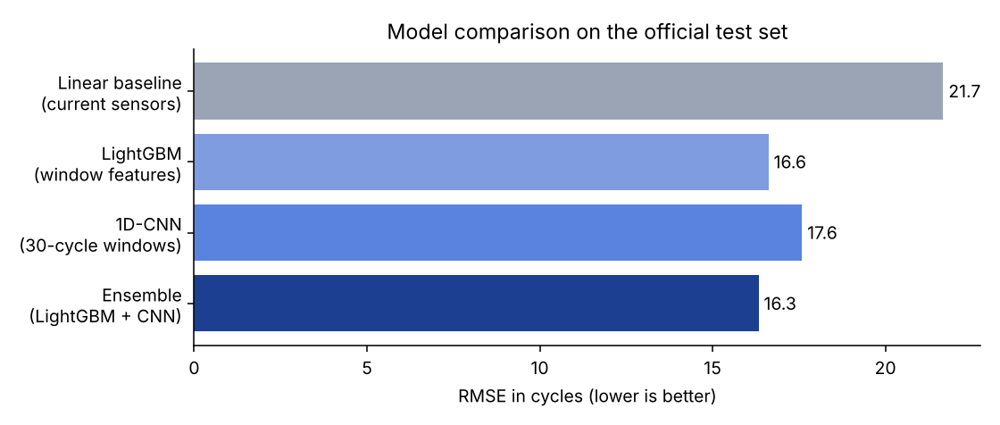
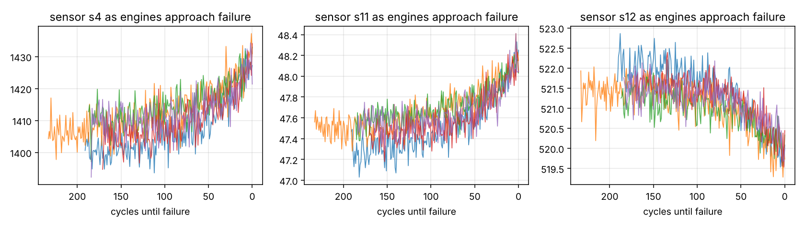

# Predictive Maintenance: Remaining Useful Life of Jet Engines

Predicts **how many operating cycles a turbofan engine has left before failure**, from 14 sensor streams (temperatures, pressures, fan and core speeds). This lets maintenance be scheduled *before* a breakdown instead of on a fixed calendar or after something fails, which is how factories and airlines cut downtime.

## Results on NASA's official test set (100 unseen engines)

| Model | RMSE (cycles) | MAE | Within ±15 cycles | Error when < 30 cycles left | NASA score ↓ |
|---|---|---|---|---|---|
| Linear baseline (current sensors only) | 21.7 | 17.4 | 51% | 19.7 | 1286 |
| 1D-CNN on 30-cycle windows (PyTorch) | 17.6 | 13.2 | 66% | 7.2 | 627 |
| LightGBM on window features | 16.6 | 12.3 | 65% | **3.2** | **470** |
| **Ensemble (LightGBM + CNN)** | **16.3** | 12.3 | **68%** | 4.6 | 472 |

- The ensemble cuts the error by **25%** versus the baseline.
- When an engine is **close to failure** (fewer than 30 cycles left, 25 test engines), LightGBM is off by only **3.2 cycles on average**. That's the moment that matters for scheduling maintenance.
- The **NASA score** penalises predicting failure *too late* more than *too early*, because a late call means an engine fails in service. LightGBM has the lowest (best) score.

All numbers are in [`reports/metrics.json`](reports/metrics.json).

## What the sensors show
Several sensors drift steadily as an engine wears out. The models learn these degradation trends, not single readings:

## Approach
- **Target:** remaining cycles, capped at 125 (a "piecewise-linear" target). A healthy engine early in life shows no measurable wear, so asking a model to tell 300 cycles left from 200 only adds noise. This is the standard setup for this benchmark.
- **Cleaning:** removed 7 sensors that are constant in this dataset.
- **LightGBM:** for every sensor, the current value plus the mean, standard deviation and slope over the last 30 cycles (56 features).
- **1D-CNN:** three 1-D convolution layers read the raw 30-cycle window of 14 standardised sensors directly.
- **Validation:** 20 training engines held out for early stopping and checkpoint selection. The official test set is used only once, for the final numbers.

## Data
[NASA C-MAPSS](https://www.nasa.gov/intelligent-systems-division/discovery-and-systems-health/pcoe/pcoe-data-set-repository/) turbofan degradation simulation, subset FD001: 100 training engines run to failure, 100 test engines cut off at an unknown point, plus the true remaining life for each.

## Source code
The source code is kept private. I'm happy to walk through the implementation, design decisions and results in an interview: [LinkedIn](https://www.linkedin.com/in/mohamed-atef-elsayed) · [Email](mailto:mohamed300atef@gmail.com)

## Author
**Mohamed Atef Elsayed**, AI Engineer · ML Engineer · Data Scientist
[LinkedIn](https://www.linkedin.com/in/mohamed-atef-elsayed) · [Portfolio](https://mohamedatefelsayed.vercel.app)
